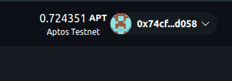

# Balance

Displays the balance of a given address in the native token of the target network (for example MOVE on Movement, APT on Aptos). The symbol comes from `native_token_symbol` in [`defaultChains`](../utils/chains.md), and falls back to APT. Shows a loading placeholder while fetching, and `Error` if the balance cannot be fetched.

## Screenshot


## Usage

```tsx
import { Balance } from "~~/components/scaffold-move";
import { useWallet } from "@aptos-labs/wallet-adapter-react";

const { account, connected } = useWallet();
<Balance address={account?.address as string} />
```

## Parameter
| Parameter                | Type     | Default Value | Description                                                                                                               |
| ------------------------ | -------- | ------------- | ------------------------------------------------------------------------------------------------------------------------- |
| **address**              | `string` | `undefined`   | Address in `0x___` format. |
