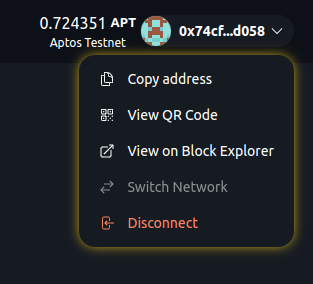

# CustomConnectButton

Scaffold Move includes a custom Wallet Connect button with the following features:

- **Balance Display**: Shows native token balance of connected address.
- **Chain Name**: Displays connected blockchain name.
- **Custom Modal**: Offers address copying, QR code view, block explorer link, network switching, a faucet option, and disconnect option.

The wallet dropdown shows a "Faucet" option for networks with a `faucet_api` in [Chains](../utils/chains.md) (such as Movement testnet and the local network): it sends 1 token to the connected account. For networks that only have a `faucet_url` (such as Aptos testnet), "Faucet" links to the faucet page instead. "Switch Network" appears when `targetNetworks` has more than one network. It is disabled for Petra, which rejects network changes from the app; switch networks in Petra and the app follows.

The connect dialog lists the detected wallets, and wallets that are not detected, with install links, under "More Wallets". See [supported wallets](../quickstart/quickstart.md#supported-wallets).

## Screenshot


## Usage
```tsx
import { CustomConnectButton } from "~~/components/scaffold-move";
<CustomConnectButton />
```
